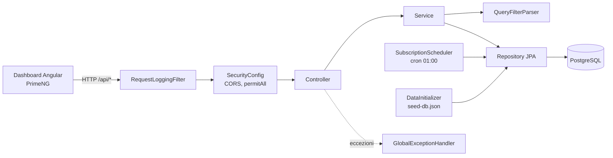

# 🏗️ Architettura di Sistema

Architettura a layer sotto `com.apexflow`: `controller` → `service` → `repository` → `model`. Dipendenze solo via costruttore, mai `@Autowired` sui campi.



## Layer e responsabilità

| Package | Responsabilità |
|---|---|
| `controller` | Mappa le rotte REST, imposta `X-Total-Count` e gli status HTTP (`200`, `201`, `204`, `404`). |
| `service` | Logica di dominio. `@Transactional(readOnly = true)` a livello di classe, `@Transactional` sui metodi che scrivono. |
| `repository` | `JpaRepository` + `JpaSpecificationExecutor` per i filtri dinamici. |
| `model` | Entità JPA: `Customer`, `Order`, `OrderItem`, `Product`, `User`, `CustomerStats`. |
| `util` | `QueryFilterParser`: parametri HTTP → `Pageable` e `Specification`. |
| `config` | `SecurityConfig`, `RequestLoggingFilter`, `DataInitializer`. |
| `scheduler` | `SubscriptionScheduler`: scadenza notturna degli abbonamenti. |
| `exception` | `GlobalExceptionHandler` e il record `ApiError`. |

## Middleware

- **CORS** (`SecurityConfig`): origini `*`, metodi `GET, POST, PUT, PATCH, DELETE, OPTIONS`, header esposti `X-Total-Count` e `Authorization`, così PrimeNG legge il totale per la paginazione.
- **Sicurezza**: CSRF disabilitato e `anyRequest().permitAll()`. Il token che la dashboard invia non viene verificato dal backend.
- **Logging** (`RequestLoggingFilter`): una riga per richiesta.

```java
// src/main/java/com/apexflow/config/RequestLoggingFilter.java
log.info("req method={} uri={} status={} durationMs={}",
        request.getMethod(), request.getRequestURI(), response.getStatus(), duration);
```

!!! warning "Limite noto"
    Con `permitAll()` e CORS aperto a qualsiasi origine, l'API è pubblica. Va bene per una demo di tesi, non per dati reali: lì servirebbe la validazione del token (es. Spring Security Resource Server) e una lista di origini consentite.
