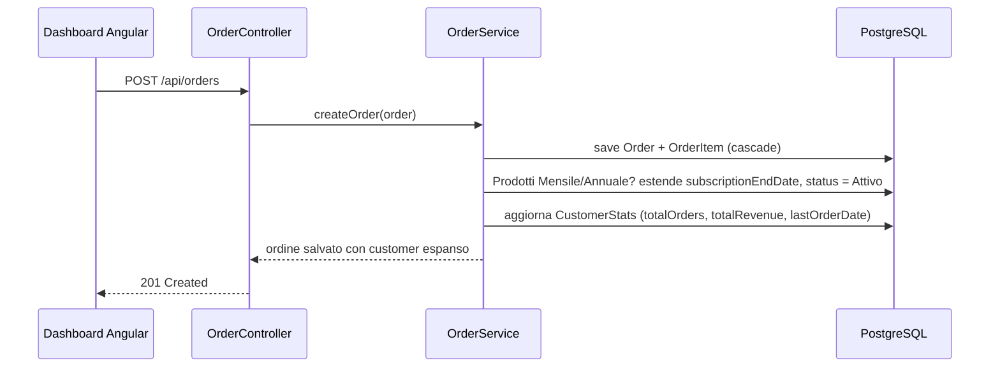

# 🚀 ApexFlow Backend

API REST in **Spring Boot 4** e **Java 21** che serve la dashboard Angular 19 + PrimeNG di ApexFlow: clienti, prodotti, ordini, utenti e statistiche per cliente, su PostgreSQL.

## Il problema

La dashboard nasce contro un mock `json-server` (`db.json`), che parla un dialetto preciso: `_page`, `_limit`, `_sort`, `*_like`, `_embed`, `_expand` e il totale nell'header `X-Total-Count`. Un backend reale doveva sostituire il mock **senza cambiare il frontend**, aggiungendo ciò che un mock non sa fare: transazioni, logica di dominio sugli abbonamenti, job pianificati, errori coerenti.

## La soluzione

- Un parser unico (`QueryFilterParser`) traduce i parametri `json-server` in `Pageable` e `Specification` JPA, così ogni risorsa ha filtri e paginazione senza codice dedicato.
- La creazione di un ordine è una transazione che estende l'abbonamento del cliente e aggiorna le sue statistiche.
- Uno scheduler notturno porta a `Scaduto` i clienti con abbonamento oltre la data di fine.
- Gli errori escono tutti nello stesso formato `ApiError`, gestiti da `GlobalExceptionHandler`.

## Flusso tipico: la dashboard crea un ordine

## Stack

| Area | Scelta |
|---|---|
| Linguaggio | Java 21 |
| Framework | Spring Boot 4.0.1 (Web MVC, Data JPA, Security, Actuator) |
| Database | PostgreSQL, schema gestito da Hibernate (`ddl-auto=update`) |
| Query dinamiche | Spring Data JPA `Specification` (Criteria API) |
| Errori | `@RestControllerAdvice` + record `ApiError`, Problem Details abilitati |
| Build | Maven Wrapper (`./mvnw`) |
| Deploy | Docker multi-stage (Eclipse Temurin 21) su Render |
| Frontend | Angular 19 + PrimeNG (repository `dashboard-tesi`) |
